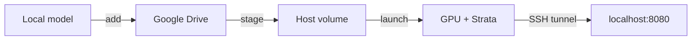

# Vast Swiss Knife

A small CLI for finding Vast.ai GPUs, staging models on Google Drive, and launching a local Strata API through SSH.



## Setup

```bash
python3 -m venv .venv
.venv/bin/pip install -r requirements.txt
cp .env.example .env                  # set VAST_API_KEY privately
rclone config                         # configure your Google Drive remote
```

Requires `rclone`, `ssh`, a Vast Google Drive connection, and an SSH key added to Vast. The rclone remote and Vast connection must access the same Google Drive account. Never commit `.env`, cloud credentials, model weights, or `models/.vast/`.

## Model → GPU

```bash
# Upload a local Strata model to Google Drive models/flash/.
.venv/bin/python vast.py add flash --source /path/to/model --remote DRIVE_REMOTE

# Or register a model already on Drive without uploading it again.
.venv/bin/python vast.py import-model flash --remote DRIVE_REMOTE --folder models/flash

# Compare interruptible 5090 offers; EU is the default.
.venv/bin/python vast.py find flash --gpu RTX_5090 --hours 2

# Choose a MACHINE ID; confirm storage and transfer costs.
.venv/bin/python vast.py connections  # see Vast cloud connections
.venv/bin/python vast.py stage flash MACHINE_ID       # volume size = model + 10%
.venv/bin/python vast.py stage-status flash

# When the transfer is ready, choose an OFFER on the same machine.
.venv/bin/python vast.py launch flash OFFER_ID --bid PRICE_PER_HOUR

# In another terminal: use the tunnel opened by launch.
curl http://127.0.0.1:8080/health
```

The CLI confirms paid operations, checks model hashes after mounting, and keeps the API on loopback. `Ctrl+C` closes the tunnel; **the GPU keeps running and billing**. Cloud Copy's inventory log alone does not prove completion. Storage is billed even when the GPU is off. See [workflow and recovery](docs/project/model-workflow.md).

```bash
# Inspect and clean up after use.
.venv/bin/python vast.py list
.venv/bin/python vast.py destroy INSTANCE_ID
.venv/bin/python vast.py disks
.venv/bin/python vast.py rm-disk VOLUME_ID
```

## Supported models

The provided [Strata image](container/README.md) runs its Qwen3.8 Flash Next NVFP4 GPTQ pack. Standalone dense GGUF files, including Qwen3.8-27B `qwen35`, can be stored on Drive but **cannot currently be deployed by this Strata setup**. The engine also supports Qwen3.6-35B-A3B (`qwen35moe`), but this CLI does not yet configure it.

## Build the image

```bash
podman build -t vast-swiss-knife:local ./container
```

GitHub Actions publishes `ghcr.io/sieciowiecxyz/vast-swiss-knife:latest` from [container/](container/) on changes to the image. Set `VAST_IMAGE` to use another compatible image.
